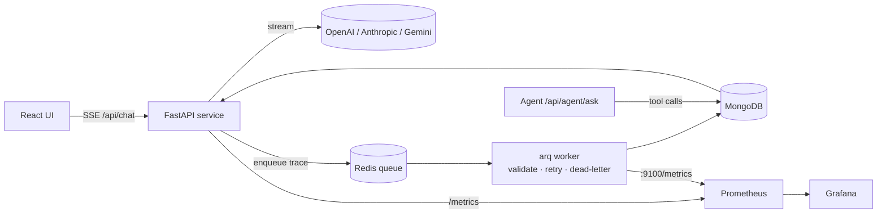

# TraceLLM

**LLM observability pipeline.** TraceLLM sits between your app and LLM providers (OpenAI, Anthropic, Gemini), streams responses to the user, and traces every call: time-to-first-token, total latency, token usage, errors. Traces flow through a Redis queue to a background worker, land in MongoDB, and surface in an analytics API, a React dashboard, Prometheus/Grafana, and an **AI agent you can ask questions in plain English** ("which model is failing the most?").



## What's in the repo

| Path | What |
|---|---|
| `python-service/` | **Main service.** FastAPI API + arq ingestion worker + tool-calling agent (Python 3.11+) |
| `web/` | React + Vite dashboard (chat and analytics views) |
| `observability/` | Prometheus scrape config and a provisioned Grafana dashboard |
| `k8s/`, `k8s/python/` | Kubernetes manifests (Mongo, Redis, API, worker, web) |
| `llmWrapper.js`, `ingestionWorker.js`, `routes/`, `models/` | The original Node.js implementation, kept for reference |

## Quick start

```bash
cp python-service/.env.example .env      # add at least one provider key
docker compose up --build
```

| Service | URL |
|---|---|
| Web UI | http://localhost:5173 |
| API docs (Swagger) | http://localhost:8000/docs |
| Prometheus | http://localhost:9090 |
| Grafana (dashboard opens by default) | http://localhost:3001 |

Without Docker: run MongoDB and Redis, then

```bash
cd python-service
python -m venv .venv && source .venv/bin/activate
pip install -r requirements-dev.txt
uvicorn app.main:app --reload --port 8000        # API
arq app.worker.WorkerSettings                    # worker, in a second terminal
```

## API

| Method | Path | Description |
|---|---|---|
| `POST` | `/api/chat` | Stream a reply as server-sent events: `data: {"delta": "..."}` … `data: {"done": true}`, or `event: error`. Body: `sessionId`, `message`, optional `provider`, `model`, `apiKey`, `temperature`, `maxTokens`, `title` |
| `GET` | `/api/sessions` | Sessions, most recently updated first |
| `GET` | `/api/sessions/{id}` | One session and its messages |
| `GET` | `/api/analytics` | Avg latency per provider (24h), hourly tokens (7d), success/error per model |
| `POST` | `/api/agent/ask` | Ask the observability agent a question (`question`, optional `provider`: `openai`/`anthropic`) |
| `GET` | `/health`, `/ready` | Liveness; readiness (checks MongoDB and Redis) |
| `GET` | `/metrics` | Prometheus metrics |

Example:

```bash
curl -N localhost:8000/api/chat -H 'content-type: application/json' \
  -d '{"sessionId":"demo","message":"Explain vector clocks in one paragraph"}'

curl localhost:8000/api/agent/ask -H 'content-type: application/json' \
  -d '{"question":"Which provider had the slowest time to first token today?"}'
```

## How it works

**Gateway** (`app/llm/gateway.py`): one async interface over three provider SDKs. It measures time-to-first-token and total time, collects token usage, records Prometheus metrics, redacts PII (emails, phone numbers, card numbers) from the stored copy, and enqueues the trace. Tracing never blocks or breaks the user's stream: if Redis is down the failure is counted (`tracellm_queue_enqueue_failures_total`) and the response still completes. Traces are also written when the client disconnects mid-stream (the enqueue runs in a cancellation-shielded scope).

**Worker** (`app/worker.py`): an arq consumer. Each payload is validated with Pydantic. Invalid payloads can never succeed, so they go straight to a dead-letter list. Database failures retry with exponential backoff (1s, 2s, 4s… capped at 30s), and after the final try the payload is dead-lettered instead of lost. Dead letters live in the Redis list `tracellm:failed-logs`.

**Agent** (`app/agent/`): a tool-calling loop. The model chooses among four read-only analytics tools (latency by provider, token throughput, errors by model, recent failures), the service runs them and feeds results back, and the model answers from real data. Guardrails: Pydantic-validated tool arguments (bad calls go back to the model as errors it can correct), unknown-tool handling, a hard step limit, read-only tools, and every agent LLM call is itself traced into TraceLLM (session `agent:<run id>`). Works with OpenAI and Anthropic through provider-neutral adapters.

**Storage**: MongoDB collections `logs` and `sessions`, with the same document shape as the Node/Mongoose models, so both implementations can share a database. Indexes: `sessions.sessionId` (unique), `logs(sessionId, createdAt)`, `logs(role, createdAt)` for the analytics range scans.

## Observability

Metrics (all prefixed `tracellm_`): `llm_requests_total{provider,model,status}`, `llm_ttfb_seconds`, `llm_duration_seconds`, `llm_tokens_total{kind}`, `http_requests_total`, `http_request_duration_seconds{route}`, `queue_enqueue_failures_total`, `worker_jobs_total{outcome}`, `agent_runs_total`, `agent_tool_calls_total`.

The Grafana dashboard (`observability/grafana/dashboards/tracellm.json`) shows calls/min, error rate, p50/p95 time-to-first-token per provider, p95 latency per model, tokens/min, worker outcomes, HTTP p95 per route, and agent activity.

## Tests

```bash
cd python-service && source .venv/bin/activate && pytest
```

27 tests, no running services or API keys needed: MongoDB is replaced by an in-memory stand-in under the real `MongoStore`, the queue by a recorder, and LLMs by scripted providers. The real OpenAI and Anthropic SDK adapters are tested against faked HTTP streams. Covered: SSE contract and Node-compatible validation errors, history, PII redaction, provider failure mid-stream, queue outage, worker store/retry/dead-letter paths, analytics numbers, the agent loop (tool use, bad arguments, unknown tools, step limit, LLM failure), metrics and readiness.

## Kubernetes

```bash
docker build -t trace-llm-py:latest python-service
kubectl apply -f k8s/            # config, secrets, Mongo, Redis, web
kubectl apply -f k8s/python/     # Python API (2 replicas) + worker
```

The API uses `/health` for liveness and `/ready` for readiness, so a pod that loses MongoDB or Redis is taken out of rotation instead of serving errors. Both deployments set resource requests/limits and Prometheus scrape annotations.

## Configuration

| Variable | Default |
|---|---|
| `MONGODB_URI` | `mongodb://localhost:27017/tracellm` |
| `REDIS_URL` | `redis://localhost:6379` |
| `LLM_PROVIDER` | `openai` |
| `OPENAI_API_KEY`, `ANTHROPIC_API_KEY`, `GEMINI_API_KEY` | (none) |
| `OPENAI_MODEL`, `ANTHROPIC_MODEL`, `GEMINI_MODEL` | `gpt-4o-mini`, `claude-haiku-5-5`, `gemini-2.5-flash` |
| `INGESTION_WORKER_CONCURRENCY` / `INGESTION_MAX_TRIES` | `5` / `3` |
| `AGENT_MAX_STEPS` | `5` |
